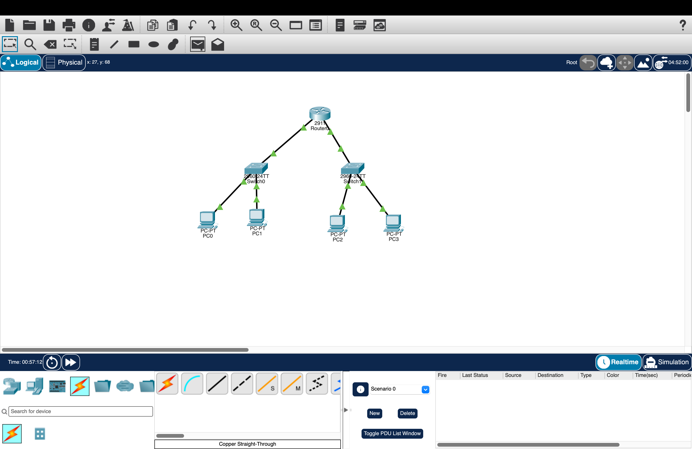
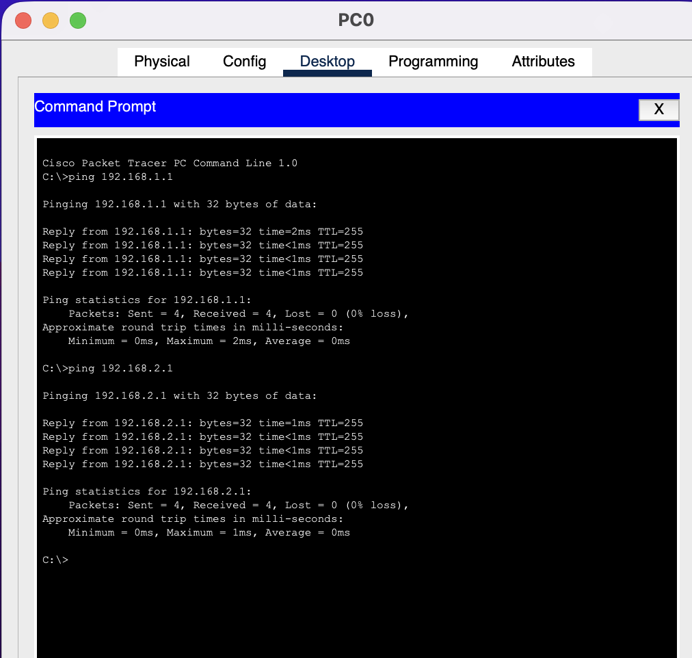
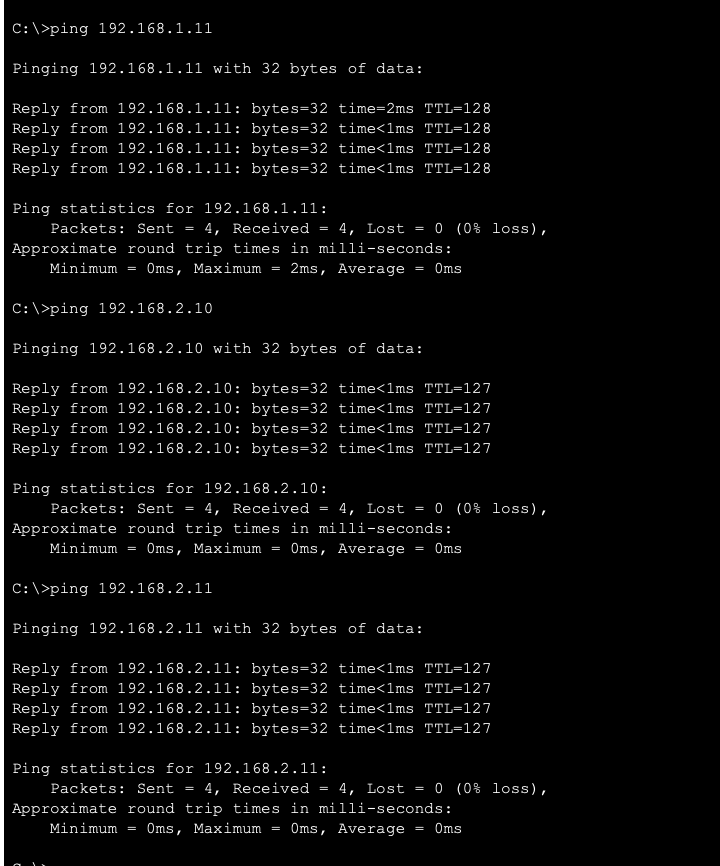

# Office Network – Cisco Packet Tracer

## 1. Introduction

In this project, I created and configured a small office network using Cisco Packet Tracer.

The network consists of two separate departments connected through one router. Each department has its own switch and two computers.

The goal was to understand how switches and routers work, configure IP addresses, and test communication between devices.

## 2. Network Overview

### Equipment

- 1 Cisco 2911 Router
- 2 Cisco 2960-24TT Switches
- 4 PCs
- Copper Straight-Through Ethernet cables

### Network Structure

**Department 1 – Network 192.168.1.0/24**

- PC0: 192.168.1.10
- PC1: 192.168.1.11
- Gateway: 192.168.1.1
- Switch0

**Department 2 – Network 192.168.2.0/24**

- PC2: 192.168.2.10
- PC3: 192.168.2.11
- Gateway: 192.168.2.1
- Switch1

### IP Address Table

| Device | IP Address | Subnet Mask | Gateway |
|---|---|---|---|
| Router0 – Network 1 | 192.168.1.1 | 255.255.255.0 | — |
| Router0 – Network 2 | 192.168.2.1 | 255.255.255.0 | — |
| PC0 | 192.168.1.10 | 255.255.255.0 | 192.168.1.1 |
| PC1 | 192.168.1.11 | 255.255.255.0 | 192.168.1.1 |
| PC2 | 192.168.2.10 | 255.255.255.0 | 192.168.2.1 |
| PC3 | 192.168.2.11 | 255.255.255.0 | 192.168.2.1 |

## 3. Network Diagram

The network diagram shows one router connected to two switches. Each switch connects two computers.

## 4. Network Configuration

I connected all devices using Copper Straight-Through cables.

I configured two router interfaces with different IP addresses:

- Network 1: 192.168.1.1/24
- Network 2: 192.168.2.1/24

I enabled both interfaces.

I also configured static IPv4 addresses on all four computers.

Each computer uses the router interface in its own network as the default gateway.

The router allows communication between the two different networks.

## 5. Network Testing

I used the `ping` command in the computers' Command Prompt to test network connectivity.

### Test Results

| Test | Result |
|---|---|
| PC0 → PC1 | Successful |
| PC0 → PC2 | Successful |
| PC0 → PC3 | Successful |
| PC0 → Gateway 192.168.1.1 | Successful |
| PC0 → Gateway 192.168.2.1 | Successful |
| PC1 → PC2 | Successful |

All devices were able to communicate successfully.

During the first tests, some packets were lost because the network was still learning the device addresses. After repeating the tests, the connections worked without packet loss.

### Ping Test Screenshots

## 6. Summary and Reflection

In this project, I learned how to create a network using Cisco Packet Tracer.

I learned how to connect computers to switches and how a router connects two different networks.

I also practiced configuring static IP addresses, subnet masks, and default gateways.

At first, some router connections were red because the interfaces were not active. After configuring and enabling the interfaces, the connections turned green.

I tested the network using ping commands and confirmed that the computers could communicate with each other.

This exercise helped me better understand how local networks work.
